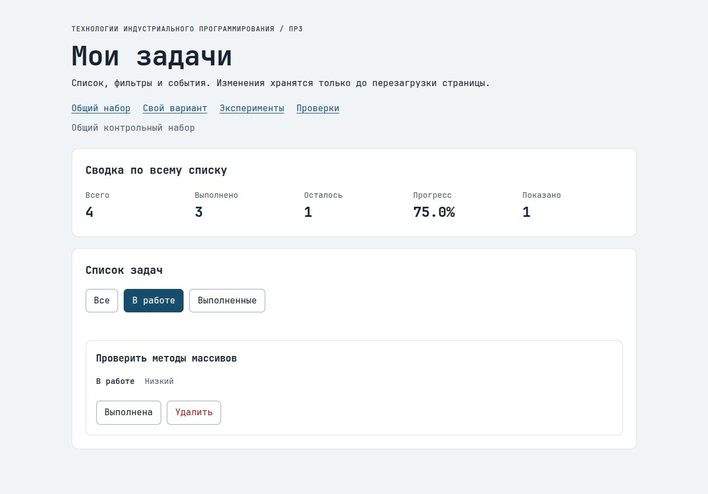

# Практическая работа № 3

Тема: работа с DOM и событиями.

## Данные работы

| Поле | Значение |
|---|---|
| Имя | Артём Петров |
| Группа | ЭФБО-01-25 |
| Вариант из ПР2 | 1 — подготовка учебного проекта |
| Среда выполнения сервера | Bun 1.4.2 |
| Браузер | ChatGPT in-app browser на движке Chromium; точный номер сборки среда не сообщает |
| Операционная система | Linux 7.0.0-44-generic, x86_64 |

## Запуск

Рабочая папка: `practice-03`.

```bash
bun run check:service
bun run start
```

После запуска доступны:

```text
http://127.0.0.1:5503/
http://127.0.0.1:5503/index.html?dataset=variant
http://127.0.0.1:5503/examples/dom-events.html
http://127.0.0.1:5503/checks.html
```

Зависимостей нет, `bun install` не требуется. Сервер останавливается через `Ctrl+C`.

## Что перенесено из ПР2

В [`src/task-service.js`](./src/task-service.js) и [`src/data.js`](./src/data.js) скопированы проверенные реализации ПР2. Сервис не обращается к DOM и не хранит глобальное состояние. Повторная проверка копии внутри ПР3 дала `35/35`, ошибок нет.

## Эксперименты

| № | До запуска: прогноз | После запуска: результат | Объяснение |
|---:|---|---|---|
| 1. Отсутствующий элемент и коллекция | `querySelector` вернёт `null`, коллекция будет иметь длину 0 | `null`, длина `NodeList` равна 0 | Отсутствующий единичный элемент и пустая коллекция представлены по-разному. |
| 2. dataset и числовой id | Значение `"23"` имеет тип `string`, после `Number` получится число `23` | `dataset.taskId: 23 string`; числовой id `23` | Значения `data-*` читаются как строки и преобразуются на границе обработчика. |
| 3. Статический NodeList | Сохранённая коллекция останется длиной 1, новый запрос покажет 3 | После двух добавлений: старый `NodeList` — 1, новый запрос — 3 | `querySelectorAll` возвращает статический снимок. |
| 4. Строка с HTML-разметкой | Теги отобразятся текстом, вложенный `strong` не появится | Заголовок равен `<strong>Это текст, а не HTML</strong>`, элементов `strong` — 0 | Используется `textContent`, а не разбор HTML. |
| 5. Распространение события | Захват контейнера, затем кнопка и всплытие к контейнеру | Фазы `1`, `3`, `3`; `target=lab-label`, `currentTarget` последовательно `lab-card`, `lab-button`, `lab-card` | Нажатие произошло по вложенному `span`, а обработчики сработали на его предках. |

## Организация кода

- [`task-service.js`](./src/task-service.js) изменяет массивы задач без мутации входных данных.
- [`task-selectors.js`](./src/task-selectors.js) формирует новый видимый массив для фильтров `all`, `pending`, `completed`.
- [`task-view.js`](./src/task-view.js) создаёт карточки DOM-методами и обновляет список, сводку и пустые состояния.
- [`main.js`](./src/main.js) хранит полный `currentTasks`, текущий `currentFilter`, обрабатывает делегированные события и вызывает сервис.

Сводка вычисляется по полному массиву через `getTaskStats`, а показатель «Показано» — по отфильтрованному массиву. Выбор фильтра не удаляет данные.

## Общий сценарий

| Шаг | Действие | Видимые id | Всего | Выполнено | Осталось | Прогресс | Показано | Сообщение | Итог |
|---:|---|---|---:|---:|---:|---:|---:|---|---|
| 0 | Исходный набор, «Все» | `[1, 4, 7, 10]` | 4 | 2 | 2 | 50.0% | 4 | — | Пройдено |
| 1 | Фильтр «В работе» | `[4, 7]` | 4 | 2 | 2 | 50.0% | 2 | — | Пройдено |
| 2 | Выполнить `id = 4` | `[7]` | 4 | 3 | 1 | 75.0% | 1 | — | Пройдено |
| 3 | Фильтр «Все» | `[1, 4, 7, 10]` | 4 | 3 | 1 | 75.0% | 4 | — | Пройдено |
| 4 | Удалить `id = 7` | `[1, 4, 10]` | 3 | 3 | 0 | 100.0% | 3 | — | Пройдено |
| 5 | Фильтр «В работе» | `[]` | 3 | 3 | 0 | 100.0% | 0 | Нет задач по выбранному фильтру | Пройдено |
| 6 | «Все», переключить `id = 1` | `[1, 4, 10]` | 3 | 2 | 1 | 66.7% | 3 | — | Пройдено |
| 7 | Удалить `1`, `4`, `10` | `[]` | 0 | 0 | 0 | 0.0% | 0 | Список задач пуст | Пройдено |

После перезагрузки восстановился исходный шаг 0. Это ожидаемо: сохранение данных появится в следующей работе.

## Индивидуальный вариант

Вариант 1 содержит шесть задач по подготовке учебного проекта с идентификаторами `[11, 23, 37, 41, 58, 64]`.

| Этап | Всего | Выполнено | Осталось | Прогресс | Видимые id | Итог |
|---|---:|---:|---:|---:|---|---|
| До действий, «Все» | 6 | 0 | 6 | 0.0% | `[11, 23, 37, 41, 58, 64]` | Пройдено |
| После переключения `23` | 6 | 1 | 5 | 16.7% | `[11, 23, 37, 41, 58, 64]` | Пройдено |
| После удаления `37` | 5 | 1 | 4 | 20.0% | `[11, 23, 41, 58, 64]` | Пройдено |
| Итог, «В работе» | 5 | 1 | 4 | 20.0% | `[11, 41, 58, 64]` | Пройдено |
| Итог, «Выполненные» | 5 | 1 | 4 | 20.0% | `[23]` | Пройдено |

## Протоколы проверок

- Сервис: [`checks-service-output.txt`](./checks-service-output.txt) — `35/35`, ошибок 0.
- Браузер: [`checks-browser-output.txt`](./checks-browser-output.txt) — `36/36`, ошибок 0.

Оба запуска выполнены 25.11.2026. Браузерные проверки запускались через реальный локальный HTTP-сервер, а не как `file://`.

## Собственные проверки

| № | Исходное состояние и действия | Ожидание | Фактический результат | Итог |
|---:|---|---|---|---|
| 1 | В исходном наборе трижды переключить статус `id = 4` | Нечётное число переключений завершит задачу; одно действие не дублируется | 4 / 3 / 1 / 75.0%, видны `[1, 4, 7, 10]` | Пройдено |
| 2 | Выбрать «Выполненные», удалить `id = 1`, затем вернуться в «Все» | В фильтре останется `id = 10`; полный список сохранит скрытые задачи | В фильтре `[10]`, затем в «Все» `[4, 7, 10]`; сводка 3 / 1 / 2 / 33.3% | Пройдено |
| 3 | Удалить `1`, `4`, `7`, переключить последнюю задачу `10`, открыть «В работе», затем удалить её | Корректная работа с единственной задачей и переход к полностью пустому списку | Сначала `[10]`, сводка 1 / 0 / 1 / 0.0%; после удаления нулевая сводка и «Список задач пуст.» | Пройдено |

## Отладка и клавиатура

В обработчике [`main.js`](./src/main.js) идентификатор читается из `card.dataset.taskId`. Для задачи 4 до преобразования это строка `"4"`, после `Number` — число `4`; действие — `toggle`, найденная задача имела `completed: false`. `setTaskCompleted` вернул `{ ok: true, tasks }`, после чего новый массив записан в `currentTasks` и вызван `renderApp()`.

При нажатии на вложенный `span` обработчик на `ul` находит кнопку через `closest`. После переключения фокус возвращается на новую кнопку той же задачи; если карточка исчезла из фильтра или удалена, фокус получает активный фильтр. Автоматическая проверка фокуса пройдена. Значения `777` и `4abc`, временно установленные в `data-task-id`, дали понятное сообщение и не изменили сводку.

## Материал для КР1

Для задания 4 контрольной используется общий `demoTasks`. В фильтре «В работе» после переключения `id = 4` остаётся только задача `id = 7`, а сводка показывает: всего 4, выполнено 3, осталось 1, прогресс 75.0%.

Идентификатор определяется по `data-task-id` ближайшей карточки и преобразуется в число. После успешного результата `setTaskCompleted` обновляется `currentTasks`, затем `renderApp` заново рассчитывает видимую выборку, сводку и карточки.



## Дополнительное задание

Дополнительное задание не выполнялось.

## Вывод

В ПР3 прикладная логика ПР2 подключена к браузерному интерфейсу. Изменение статуса и удаление сначала создают новое состояние данных, после чего DOM полностью согласуется с ним через повторную отрисовку. Делегирование позволяет обрабатывать кнопки пересозданных карточек одним обработчиком контейнера, а отдельное хранение фильтра не приводит к потере скрытых задач.
